<div align="center">


<a href="https://interviewpreparationportal.netlify.app/">
  
</a>

<br/><br/>

[](https://interviewpreparationportal.netlify.app/)
[](https://github.com/monika0712/interview-preparation-portal/commits/main)
[](https://github.com/monika0712/interview-preparation-portal)
[](https://github.com/monika0712/interview-preparation-portal/stargazers)

<br/>


<br/><br/>

### **🚀 [Try the Live Demo](https://interviewpreparationportal.netlify.app/)**

</div>

<br/>

<div align="center">

### 📊 At a Glance

<table width="100%">
<tr>
<td align="center" width="20%">🌐 <b>Live URL</b><br/><a href="https://interviewpreparationportal.netlify.app/"><i>Netlify</i></a></td>
<td align="center" width="20%">📦 <b>Questions</b><br/><h3>1,151</h3></td>
<td align="center" width="20%">📚 <b>Subjects</b><br/><h3>12</h3></td>
<td align="center" width="20%">🏢 <b>Companies Tagged</b><br/><h3>10</h3></td>
<td align="center" width="20%">⚙️ <b>Grading</b><br/><i>Server-side only</i></td>
</tr>
</table>

</div>

---

## 📖 Table of Contents

**🧭 Getting to know it**

&nbsp;&nbsp;📌 [Overview](#-overview) &nbsp;·&nbsp; 📸 [Screenshots](#-screenshots) &nbsp;·&nbsp; ✨ [Features](#-features) &nbsp;·&nbsp; 🔄 [How It Works](#-how-it-works)

**🛠️ Building it**

&nbsp;&nbsp;🧰 [Tech Stack](#-tech-stack) &nbsp;·&nbsp; 📁 [Project Structure](#-project-structure) &nbsp;·&nbsp; 🚀 [Getting Started](#-getting-started) &nbsp;·&nbsp; 📡 [API Reference](#-api-reference)

**🌍 Beyond the code**

&nbsp;&nbsp;☁️ [Deployment](#️-deployment-all-free-tiers) &nbsp;·&nbsp; 🛠 [Skills Demonstrated](#-skills-demonstrated) &nbsp;·&nbsp; 🗺️ [Roadmap](#️-roadmap) &nbsp;·&nbsp; 🤝 [Contributing](#-contributing) &nbsp;·&nbsp; 📬 [Contact](#-contact)

---

## 📌 Overview

> **Prep Portal** helps developers prepare for technical interviews without juggling five different tools.

Instead of scattered notes, random PDFs, and untracked practice, it brings everything — a **1,151-question bank**, mock exams, bookmarks, and progress tracking — into *one* clean dashboard.

Built solo as a full-stack **MERN** project, covering the entire flow from *JWT authentication* and *REST API design* to a *server-authoritative grading engine* and a *responsive React frontend*.

<div align="right">

[⬆ back to top](#-table-of-contents)

</div>

---

## 📸 Screenshots

### 🏠 Landing Page

<p align="center">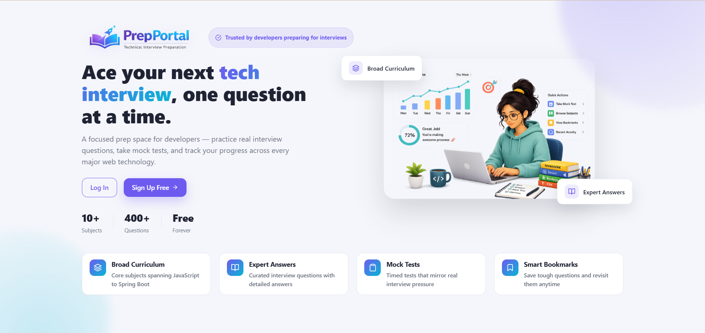</p>

### 🔐 Login & Register

<table width="100%">
<tr>
<td align="center" width="50%">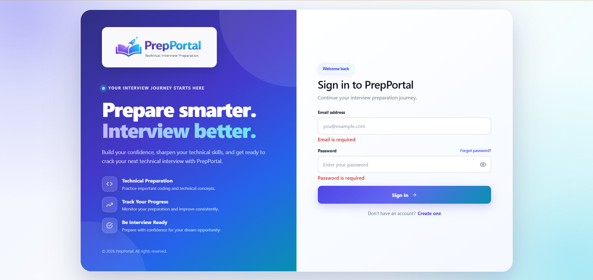<br/><sub><b>Login</b></sub></td>
<td align="center" width="50%">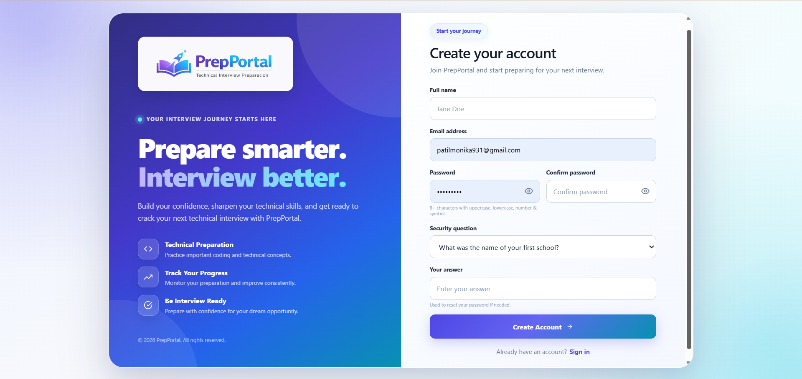<br/><sub><b>Register</b></sub></td>
</tr>
</table>

<p align="center"><i>Sign in with an existing account, or register a new one in seconds — no email verification needed.</i></p>

### 📊 Dashboard

<table width="100%">
<tr>
<td align="center" width="50%">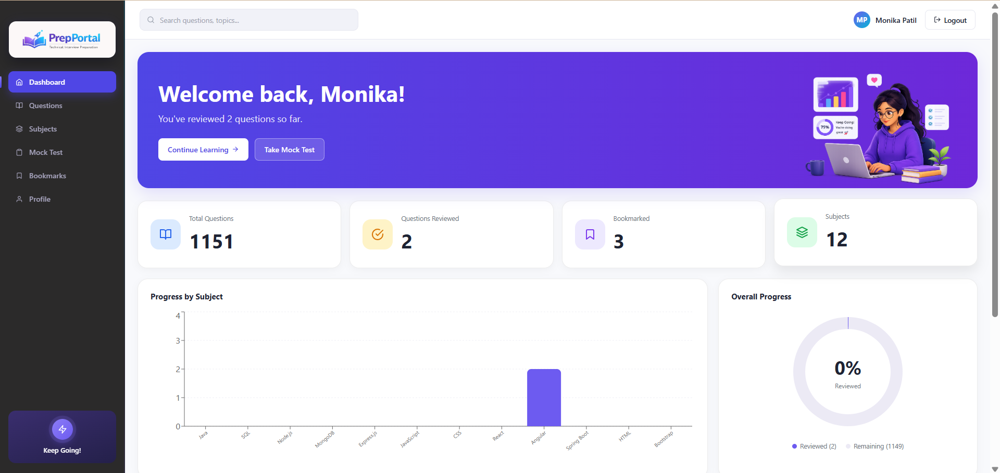<br/><sub><b>Overview</b> — live totals & completion ring</sub></td>
<td align="center" width="50%">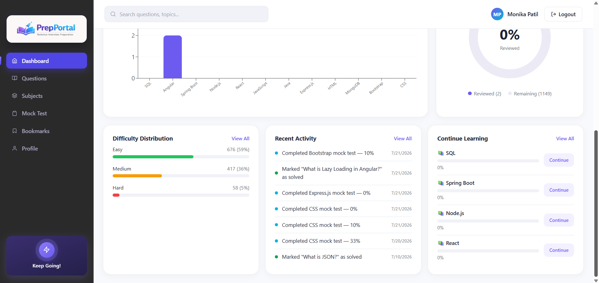<br/><sub><b>Progress & Activity</b> — per-subject chart, difficulty split, recent activity</sub></td>
</tr>
</table>

<p align="center"><i>Live totals, per-subject progress, difficulty breakdown, and recent activity — all on one screen, no clicking required.</i></p>

### 📚 Subjects & 📝 Question Bank

<table width="100%">
<tr>
<td align="center" width="50%">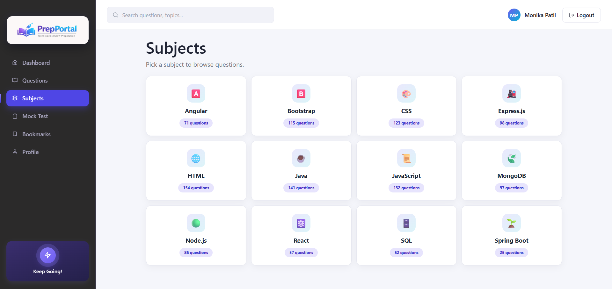<br/><sub><b>Subjects</b> — 12 subjects, 1,151 questions total</sub></td>
<td align="center" width="50%">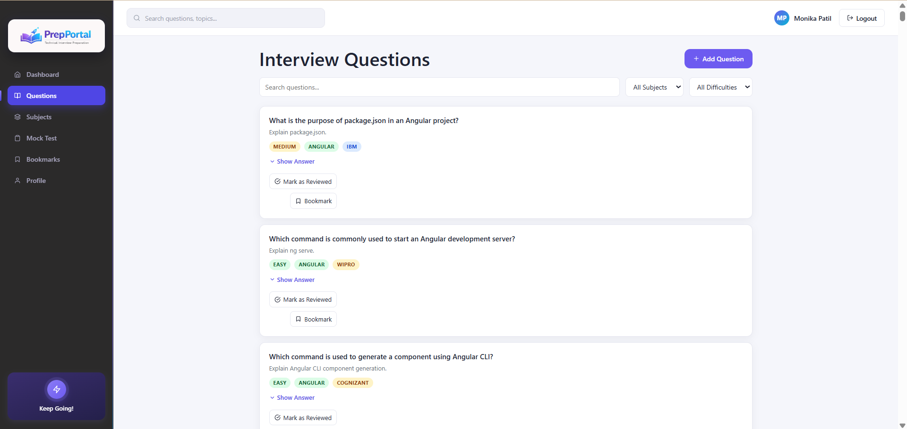<br/><sub><b>Question Bank</b> — search, filter & bookmark</sub></td>
</tr>
</table>

**🎯 Filter by difficulty — Easy · Medium · Hard**

<table width="100%">
<tr>
<td align="center" width="33%">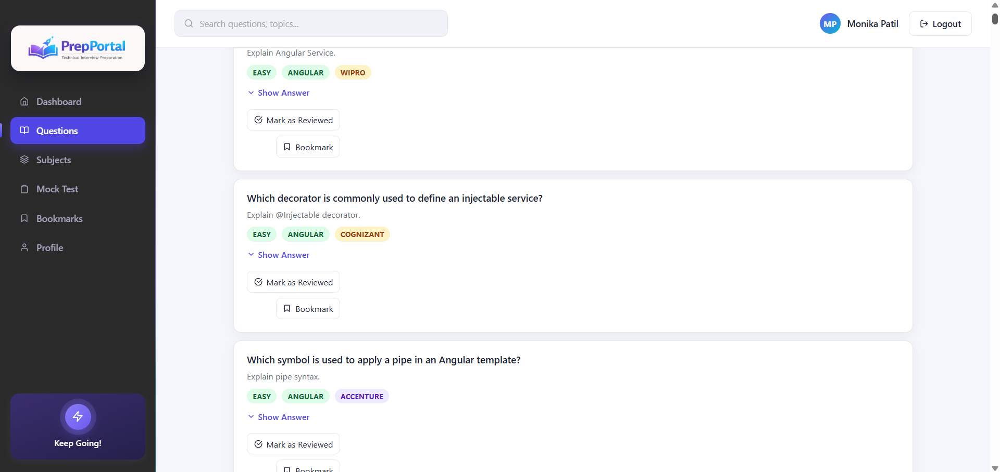<br/><sub>🟢 <b>Easy</b></sub></td>
<td align="center" width="33%">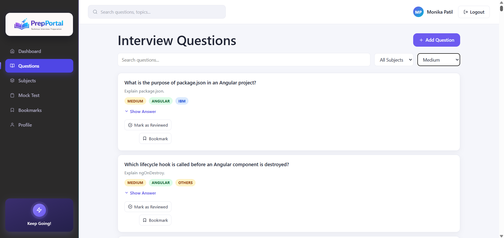<br/><sub>🟡 <b>Medium</b></sub></td>
<td align="center" width="33%">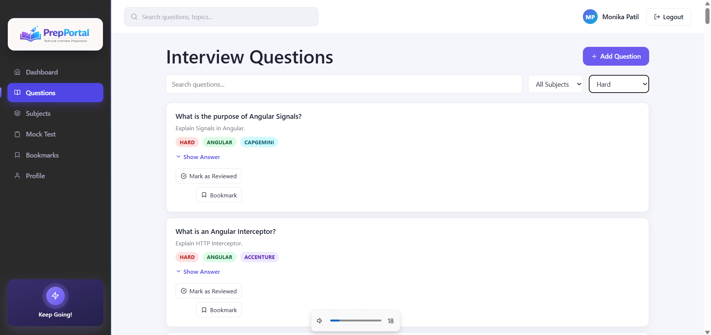<br/><sub>🔴 <b>Hard</b></sub></td>
</tr>
</table>

### 🧪 Mock Test — Setup → Live Exam → Server-Graded Result

<table width="100%">
<tr>
<td align="center" width="33%">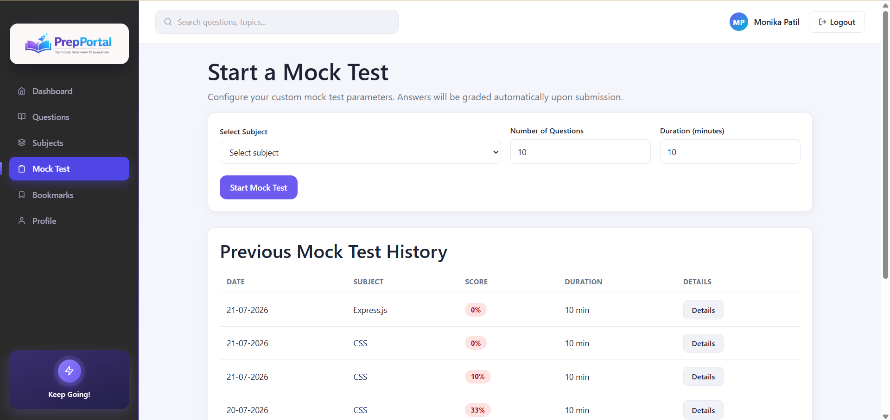<br/><sub><b>Setup</b></sub></td>
<td align="center" width="33%">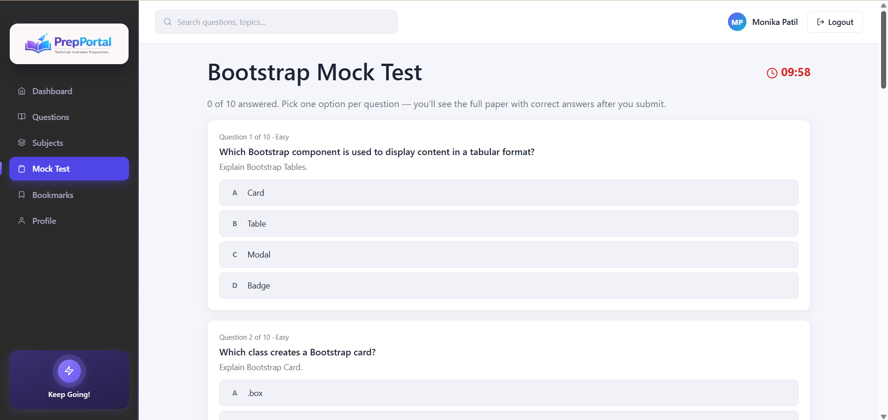<br/><sub><b>Live Exam</b></sub></td>
<td align="center" width="33%">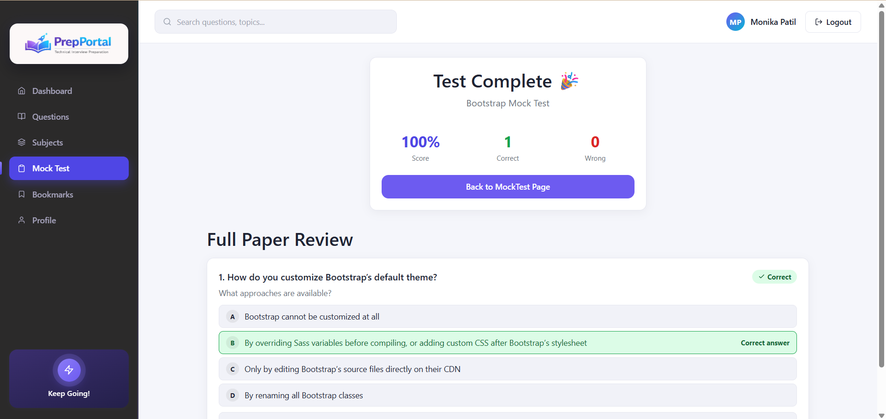<br/><sub><b>Result & Paper Review</b></sub></td>
</tr>
</table>

### 🔖 Bookmarks

<p align="center">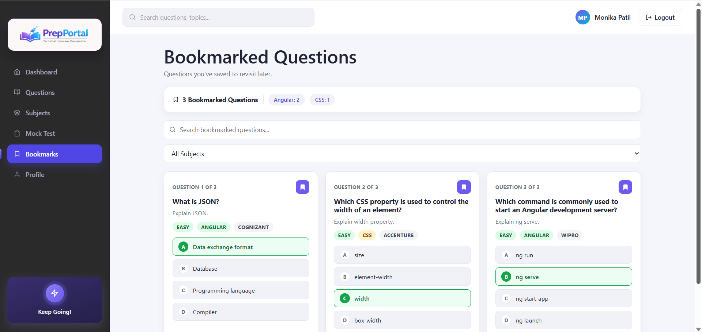</p>

### 👤 Profile

<p align="center">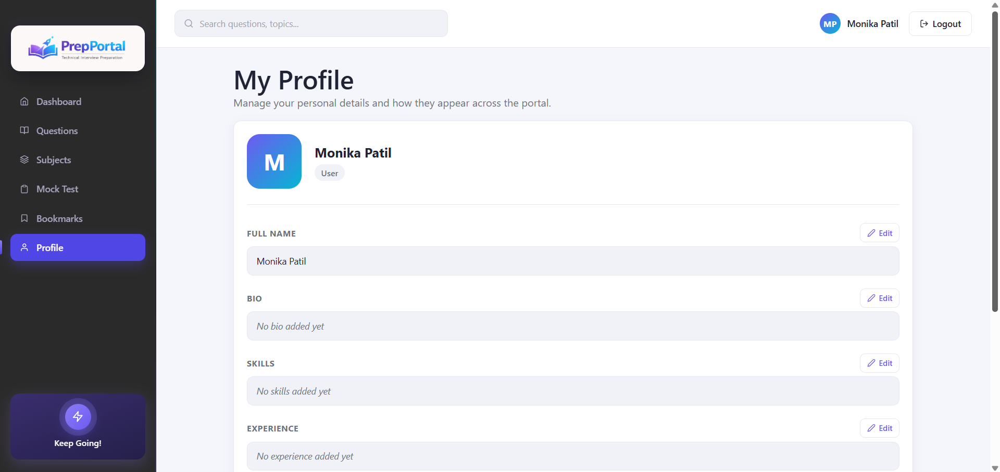</p>
<p align="center"><i>Bio, skills, institute, and experience — all editable inline, no separate settings page.</i></p>

### 🛡️ Admin Panel

<table width="100%">
<tr>
<td align="center" width="50%">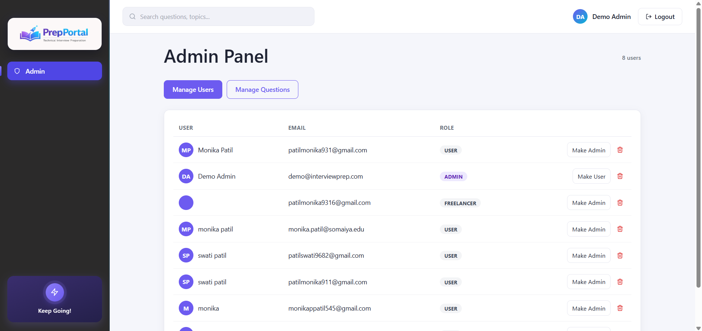<br/><sub><b>Manage Users</b> — promote, demote & remove accounts</sub></td>
<td align="center" width="50%">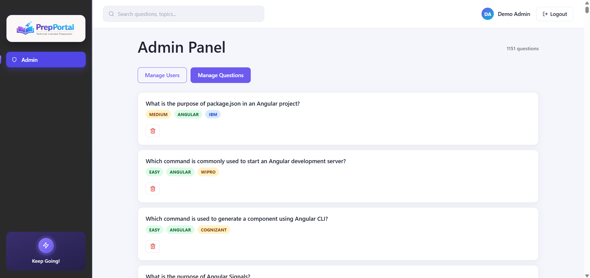<br/><sub><b>Manage Questions</b> — moderate the 1,151-question bank</sub></td>
</tr>
</table>

<div align="right">

[⬆ back to top](#-table-of-contents)

</div>

---

## ✨ Features

<table width="100%">
<tr><td>

#### 🔐 Authentication & Accounts 

</td></tr>
<tr><td>✅ &nbsp; <i>JWT-based</i> register / login / logout</td></tr>
<tr><td>✅ &nbsp; <b>Forgot-password</b> via a security question — no email service needed</td></tr>
<tr><td>✅ &nbsp; <b>Role-based access</b> (<code>user</code> / <code>admin</code>)</td></tr>

<tr><td>

#### 📊 Dashboard 

</td></tr>
<tr><td>✅ &nbsp; Live totals: <b>1,151 questions</b>, reviewed count, bookmarks, <b>12 subjects</b></td></tr>
<tr><td>✅ &nbsp; Progress-by-subject chart and an overall completion ring</td></tr>
<tr><td>✅ &nbsp; Difficulty spread and a recent-activity feed</td></tr>

<tr><td>

#### 📚 Question Bank 

</td></tr>
<tr><td>✅ &nbsp; Search, filter by <i>subject</i> / <i>difficulty</i> / <i>company</i></td></tr>
<tr><td>✅ &nbsp; Bookmark tricky questions, mark them reviewed</td></tr>
<tr><td>✅ &nbsp; <b>12 subjects</b> · <b>10 tagged companies</b></td></tr>

<tr><td>

#### 📝 Mock Tests 

</td></tr>
<tr><td>✅ &nbsp; Pick <i>subject</i>, <i>question count</i> & <i>duration</i></td></tr>
<tr><td>✅ &nbsp; Real MCQ exam, <b>graded server-side</b></td></tr>
<tr><td>✅ &nbsp; Full paper review: your answer vs. correct answer, per question</td></tr>
<tr><td>✅ &nbsp; Complete test history with score, subject, and duration logged</td></tr>

<tr><td>

#### 👤 Profile & Admin 

</td></tr>
<tr><td>✅ &nbsp; Personal profile: <i>bio</i>, <i>skills</i>, <i>institute</i>, <i>experience</i></td></tr>
<tr><td>✅ &nbsp; <b>Admin panel</b>: manage users (promote / demote / remove) and moderate questions</td></tr>

<tr><td>

#### ⚡ Built for Zero Cost 

</td></tr>
<tr><td>✅ &nbsp; No paid APIs, no email service, no license fees</td></tr>
<tr><td>✅ &nbsp; Runs entirely on <b>free tiers</b></td></tr>
</table>

<br/>

<div align="center">

**🏢 Companies tagged on questions**

<table width="95%">
<tr>
<td align="center" width="20%"></td>
<td align="center" width="20%"></td>
<td align="center" width="20%"></td>
<td align="center" width="20%"></td>
<td align="center" width="20%"></td>
</tr>
<tr>
<td align="center"></td>
<td align="center"></td>
<td align="center"></td>
<td align="center"></td>
<td align="center"></td>
</tr>
</table>

</div>

<br/>

<div align="center">

**📚 Question distribution across all 12 subjects — 1,151 total**

<table width="90%">
<tr>
<th align="left">Subject</th>
<th align="right">Questions</th>
<th align="left">Subject</th>
<th align="right">Questions</th>
<th align="left">Subject</th>
<th align="right">Questions</th>
</tr>

<tr>
<td>🌐 <b>HTML</b></td>
<td align="right">154</td>
<td>☕ <b>Java</b></td>
<td align="right">141</td>
<td>📜 <b>JavaScript</b></td>
<td align="right">132</td>
</tr>

<tr>
<td>🎨 <b>CSS</b></td>
<td align="right">123</td>
<td>🅱️ <b>Bootstrap</b></td>
<td align="right">115</td>
<td>🚂 <b>Express.js</b></td>
<td align="right">98</td>
</tr>

<tr>
<td>🍃 <b>MongoDB</b></td>
<td align="right">97</td>
<td>🟢 <b>Node.js</b></td>
<td align="right">86</td>
<td>🅰️ <b>Angular</b></td>
<td align="right">71</td>
</tr>

<tr>
<td>⚛️ <b>React</b></td>
<td align="right">57</td>
<td>🗄️ <b>SQL</b></td>
<td align="right">52</td>
<td>🍃 <b>Spring Boot</b></td>
<td align="right">25</td>
</tr>
</table>

</div>

<br/>

<div align="center">

**🎯 Difficulty spread**

<table width="80%">
<tr><th align="left" width="15%">Level</th><th align="left" width="65%">Distribution</th><th align="right" width="20%">Count</th></tr>
<tr><td>🟢 <b>Easy</b></td><td><code>████████████████████████░░░░░░░░░░░░░░░░</code> 59%</td><td align="right"><b>676</b></td></tr>
<tr><td>🟡 <b>Medium</b></td><td><code>███████████████░░░░░░░░░░░░░░░░░░░░░░░░░</code> 36%</td><td align="right"><b>417</b></td></tr>
<tr><td>🔴 <b>Hard</b></td><td><code>██░░░░░░░░░░░░░░░░░░░░░░░░░░░░░░░░░░░░░░</code> 5%</td><td align="right"><b>58</b></td></tr>
</table>

</div>

<div align="right">

[⬆ back to top](#-table-of-contents)

</div>

---

## 🔄 How It Works

**User journey, end to end:**

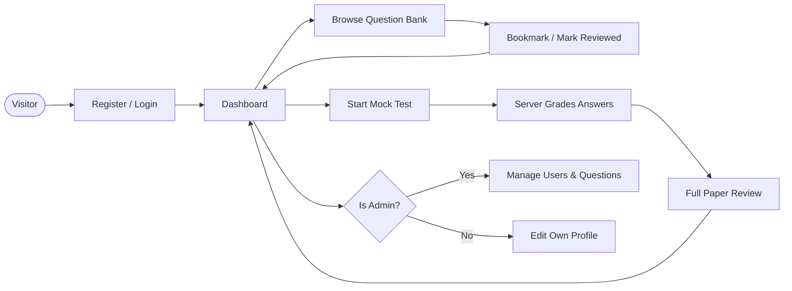

**Mock test grading — why the server is always the source of truth:**

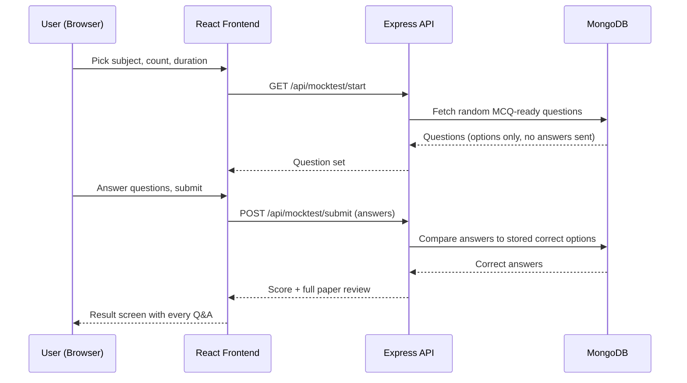

<div align="right">

[⬆ back to top](#-table-of-contents)

</div>

---

## 🧰 Tech Stack

<div align="center">


</div>

<br/>

<table width="100%">
<tr><th align="left" width="20%">Layer</th><th align="left">Technologies</th></tr>
<tr><td>🎨 <b>Frontend</b></td><td>React (Vite), React Router, Redux Toolkit, Axios, Formik, Yup, CSS Modules, React Icons</td></tr>
<tr><td>⚙️ <b>Backend</b></td><td>Node.js, Express.js, JWT, bcryptjs</td></tr>
<tr><td>🗄️ <b>Database</b></td><td>MongoDB + Mongoose <i>(local or MongoDB Atlas free tier)</i></td></tr>
<tr><td>☁️ <b>Deployment</b></td><td>Frontend → Netlify · Backend → Render · Database → MongoDB Atlas</td></tr>
</table>

<div align="right">

[⬆ back to top](#-table-of-contents)

</div>

---

## 📁 Project Structure

```
interview-prep-portal/
├── backend/
│   ├── config/db.js
│   ├── data/               # 12 question banks (React, Node, Java, SQL, Spring Boot, ...)
│   ├── models/             # User, Question, Subject, Bookmark, Result
│   ├── middleware/         # auth (JWT), admin
│   ├── controllers/
│   ├── routes/
│   ├── utils/              # generateToken, seedData
│   └── server.js
├── frontend/
│   └── src/
│       ├── app/store.js
│       ├── api/axiosInstance.js
│       ├── features/       # auth, dashboard, questions, subjects, bookmarks, mocktest, profile, admin
│       └── components/     # Navbar, Sidebar, Layout, ProtectedRoute
└── screenshots/            # README preview images
```

<div align="right">

[⬆ back to top](#-table-of-contents)

</div>

---

## 🚀 Getting Started

### ✅ Prerequisites
- **Node.js 18+**
- **MongoDB** running locally, *or* a free [MongoDB Atlas](https://www.mongodb.com/cloud/atlas/register) cluster

### 1️⃣ Clone the repo
```bash
git clone https://github.com/monika0712/interview-preparation-portal.git
cd interview-preparation-portal
```

### 2️⃣ Backend setup
```bash
cd backend
npm install
cp .env.example .env
```

Edit `.env` with your own values:
```env
PORT=5000
MONGO_URI=mongodb://localhost:27017/interview_prep
JWT_SECRET=change_this_to_a_long_random_secret
JWT_EXPIRE=7d
CLIENT_URL=http://localhost:5173
```

Seed the database with **12 subjects**, **1,151 interview questions**, and a demo admin account:
```bash
npm run seed
npm run dev
```
The API runs at `http://localhost:5000/api`.

### 3️⃣ Frontend setup
In a new terminal:
```bash
cd frontend
npm install
cp .env.example .env
npm run dev
```
The app runs at `http://localhost:5173`.

### 4️⃣ Log in

<table width="100%">
<tr><th align="left">Account</th><th align="left">Email</th><th align="left">Password</th></tr>
<tr><td><b>Demo admin</b></td><td><code>demo@interviewprep.com</code></td><td><code>demo1234</code></td></tr>
</table>

Or register your own account at `/register` — you'll still see all seeded questions, but your personal reviewed/bookmark counts start at zero.

### 🔧 Promote your own account to admin *(optional)*

Run in `mongosh`:
```js
use interview_prep
db.users.updateOne({ email: "you@example.com" }, { $set: { role: "admin" } })
```
Log out and back in — you'll see the **Admin** link in the sidebar.

<div align="right">

[⬆ back to top](#-table-of-contents)

</div>

---

## 📡 API Reference

### 🔐 Auth

<table width="100%">
<tr><th align="left" width="10%">Method</th><th align="left" width="35%">Endpoint</th><th align="left">Description</th></tr>
<tr><td></td><td><code>/api/auth/register</code></td><td>Create account</td></tr>
<tr><td></td><td><code>/api/auth/login</code></td><td>Log in, returns JWT</td></tr>
<tr><td></td><td><code>/api/auth/forgot-password/question</code></td><td>Get security question</td></tr>
<tr><td></td><td><code>/api/auth/forgot-password/reset</code></td><td>Reset password</td></tr>
</table>

### 📚 Questions & Bookmarks

<table width="100%">
<tr><th align="left" width="10%">Method</th><th align="left" width="35%">Endpoint</th><th align="left">Description</th></tr>
<tr><td></td><td><code>/api/questions</code></td><td>List / search / filter questions</td></tr>
<tr><td></td><td><code>/api/questions</code></td><td>Create question</td></tr>
<tr><td></td><td><code>/api/questions/:id</code></td><td>Update question</td></tr>
<tr><td></td><td><code>/api/questions/:id</code></td><td>Delete question</td></tr>
<tr><td></td><td><code>/api/questions/:id/solve</code></td><td>Toggle reviewed</td></tr>
<tr><td></td><td><code>/api/bookmarks</code></td><td>List / toggle bookmarks</td></tr>
<tr><td></td><td><code>/api/subjects</code></td><td>List subjects</td></tr>
</table>

### 📝 Mock Test & Dashboard

<table width="100%">
<tr><th align="left" width="10%">Method</th><th align="left" width="35%">Endpoint</th><th align="left">Description</th></tr>
<tr><td></td><td><code>/api/mocktest/start</code></td><td>Get random questions for a test</td></tr>
<tr><td></td><td><code>/api/mocktest/submit</code></td><td>Submit test result <i>(server-graded)</i></td></tr>
<tr><td></td><td><code>/api/dashboard</code></td><td>Dashboard stats</td></tr>
</table>

### 👤 Profile & Admin

<table width="100%">
<tr><th align="left" width="10%">Method</th><th align="left" width="35%">Endpoint</th><th align="left">Description</th></tr>
<tr><td></td><td><code>/api/profile</code></td><td>View / update profile</td></tr>
<tr><td></td><td><code>/api/admin/users</code></td><td>List all users</td></tr>
<tr><td></td><td><code>/api/admin/users/:id/role</code></td><td>Promote / demote a user</td></tr>
<tr><td></td><td><code>/api/admin/users/:id</code></td><td>Remove a user</td></tr>
<tr><td></td><td><code>/api/admin/questions/:id</code></td><td>Remove a question</td></tr>
</table>

<div align="right">

[⬆ back to top](#-table-of-contents)

</div>

---

## ☁️ Deployment (all free tiers)

<table width="100%">
<tr><th align="left" width="20%">Service</th><th align="left" width="20%">Where</th><th align="left">Notes</th></tr>
<tr><td>🎨 <b>Frontend</b></td><td><a href="https://netlify.com">Netlify</a></td><td>Build command: <code>npm run build</code>, publish dir: <code>dist</code></td></tr>
<tr><td>⚙️ <b>Backend</b></td><td><a href="https://render.com">Render</a></td><td>Root: <code>backend</code>, build: <code>npm install</code>, start: <code>npm start</code></td></tr>
<tr><td>🗄️ <b>Database</b></td><td><a href="https://www.mongodb.com/cloud/atlas/register">MongoDB Atlas</a></td><td>Free M0 cluster</td></tr>
</table>

<div align="right">

[⬆ back to top](#-table-of-contents)

</div>

---

## 🛠 Skills Demonstrated

<table width="100%">
<tr>
<td valign="top" width="33%">

**🎨 Frontend**
- Component-driven React + Vite
- Redux Toolkit for global state
- Formik + Yup form validation
- Protected, role-based routing

</td>
<td valign="top" width="33%">

**⚙️ Backend**
- RESTful API design in Express
- JWT auth & middleware
- Server-authoritative grading logic
- Mongoose schema design across 12 question banks

</td>
<td valign="top" width="33%">

**🏗️ Engineering**
- Secrets kept out of Git via `.env`
- Zero-cost deployment pipeline
- Clean, incremental Git history

</td>
</tr>
</table>

<div align="right">

[⬆ back to top](#-table-of-contents)

</div>

---

## 🗺️ Roadmap

<table width="100%">
<tr><th align="left" width="70%">Item</th><th align="center">Status</th></tr>
<tr><td>Pagination for the 1,151-question list</td><td align="center"></td></tr>
<tr><td>Recharts-powered analytics on the progress tracker</td><td align="center"></td></tr>
<tr><td>Profile photo upload <i>(Cloudinary free tier)</i></td><td align="center"></td></tr>
<tr><td>Per-question discussion threads</td><td align="center"></td></tr>
</table>

<div align="right">

[⬆ back to top](#-table-of-contents)

</div>

---

## 🤝 Contributing

Contributions, issues, and feature requests are welcome!

<table width="100%">
<tr><th align="center" width="10%">Step</th><th align="left">Action</th></tr>
<tr><td align="center">1️⃣</td><td>Fork the project</td></tr>
<tr><td align="center">2️⃣</td><td>Create your feature branch — <code>git checkout -b feature/amazing-feature</code></td></tr>
<tr><td align="center">3️⃣</td><td>Commit your changes — <code>git commit -m 'Add amazing feature'</code></td></tr>
<tr><td align="center">4️⃣</td><td>Push to the branch — <code>git push origin feature/amazing-feature</code></td></tr>
<tr><td align="center">5️⃣</td><td>Open a Pull Request</td></tr>
</table>

<div align="right">

[⬆ back to top](#-table-of-contents)

</div>

---

## 📬 Contact

<div align="center">

**Abhishek Kushwaha**

[](mailto:abhishek8888raj@gmail.com)
[](https://github.com/abhishek23027kushwaha)
[](https://interviewpreparationportal.netlify.app/)

### ⭐ If this project helped you, consider giving it a star — it really helps!


</div>
